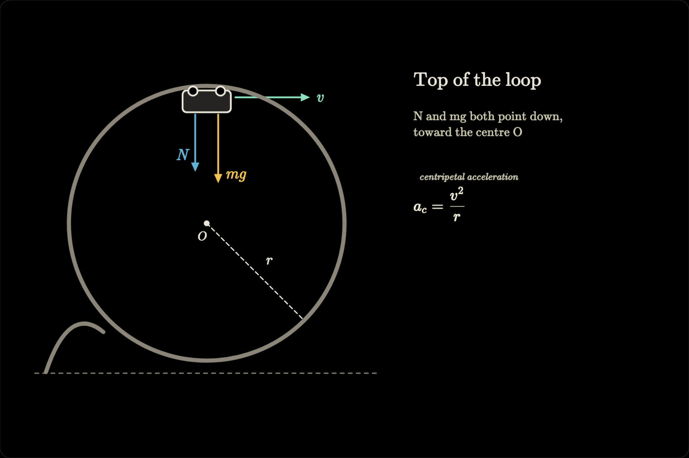
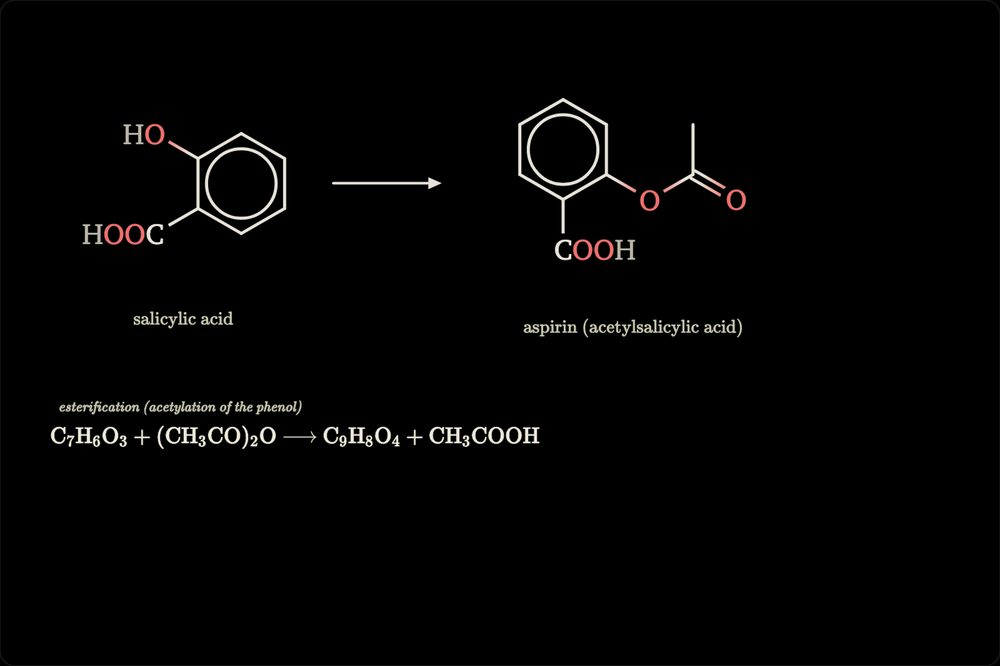
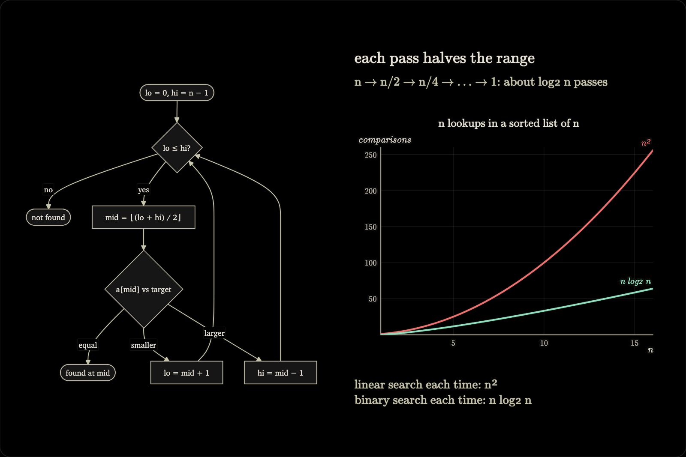
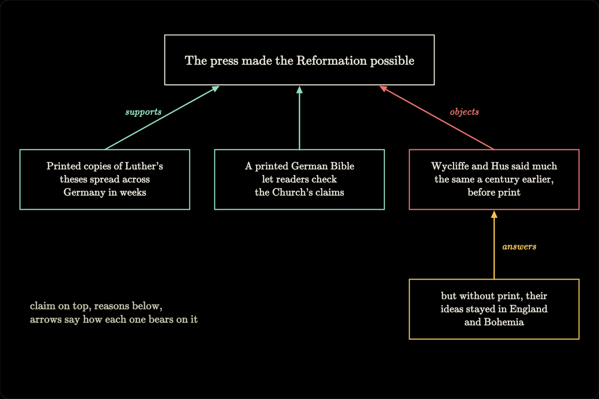

# math-board

[](https://github.com/smdesai27/math-board/actions/workflows/ci.yml)

A black chalkboard in the browser that a terminal tutor draws on while it explains, like a professor at a blackboard. The conversation stays in the terminal. The board is view-only: the model puts up equations, plots, molecules, diagrams and science illustrations through tools, one step at a time, and you watch, step back through the lesson, pan and zoom. You never draw on it. The model does. (The page has two buttons that change anything: Clear, which wipes the board after asking, and Save.)

A terminal tutor has no visual channel, and much of what people learn needs a picture. This gives it one. It's an extension for [pi](https://github.com/earendil-works/pi), a terminal coding agent, and the same tools run as an MCP server for Claude Code and other MCP clients. It's local and free (no cloud, no extra API keys). A [survey](docs/alternatives-2026-10-27.md) of about a hundred existing tools found none that was view-only, local, lesson-structured and agent-driven at once.



## Install for pi

You need pi and Node 22.19 or later. It works on macOS and Linux. On Windows the board runs, but nothing opens the browser for you, so open the URL from `/board` yourself.

From npm, once it's published:

```sh
pi install npm:pi-math-board
```

From a checkout:

```sh
git clone https://github.com/smdesai27/math-board ~/math-board
cd ~/math-board && npm ci
pi install ~/math-board
```

pi loads a local package in place, without copying it, so the checkout is what runs. It doesn't install a local package's dependencies, which is why `npm ci` comes first. Then run `/reload` in pi, or restart it.

Two things worth knowing first:

- The layout check after each update, `board_snapshot` and the PNGs from `/board export` need a headless Chromium: Playwright's or the system Chrome. For Playwright's, install the build the package expects with `npx -y playwright-core@1.64.1 install chromium` (the error message names the exact command). Without one the board still works, and those report why they can't. Chromium runs with its OS sandbox; where the sandbox can't start (some Linux containers) it runs without it, and the results say so.
- Where the boards live: a checkout keeps them in `.data/` next to the code (git-ignored). An installed copy, from npm or pi's git installs, gets replaced or cleaned on update, so it keeps them in a per-user folder instead: `~/Library/Application Support/math-board` on macOS, `$XDG_STATE_HOME/math-board` (usually `~/.local/state/math-board`) on Linux, `%LOCALAPPDATA%\math-board` on Windows. `MATH_BOARD_DATA_DIR` overrides both (`PI_MATH_BOARD_DATA_DIR`, the old name, still works). `/board status` shows which folder is in use.

## Use it in pi

Ask the tutor to explain something "on the board". Or:

```text
/board                 open the board in your browser (also /board open)
/board status          server URL, revision, data folder, viewers, autosave problems
/board save <name>     named snapshot (several words become one name: my lesson -> my-lesson)
/board load <name>     restore it
/board export [name]   write the lesson to ./viz/: board.json, PNGs, lesson.md
/board clear           clear everything (or /board clear equations|scene)
/board stop            stop the server
```

The server starts on first use and listens only on `127.0.0.1`. The URL carries a private `#token=…`; don't share it. After `/reload` or `/board stop` the next board in the same pi session reuses the port and token, so a tab that's still open reconnects by itself. If the server is gone for good, the page says so after about 10 seconds and keeps trying in the background.

## Use it from Claude Code and other MCP clients

The same tools run as a stdio MCP server, `mcp/server.mjs`. Both the pi extension (`index.ts`) and the MCP server are thin adapters over one implementation, `tools.mjs`, so the model gets the same tool names, descriptions, schemas and results either way, and the `board_teaching` rhythm (read, draw one step, ask one check question) is the server's instructions. One learner workflow, whichever agent is teaching.

Register it with Claude Code once:

```sh
claude mcp add math-board -- npx -y pi-math-board              # from npm, once published
claude mcp add math-board -- node ~/math-board/mcp/server.mjs  # from a checkout, after npm ci
```

That registers it for the folder you run it in (scope `local`), so the board and its instructions exist only there; add `--scope user` for every project. `claude mcp list` should show `✔ Connected`, and `/mcp` inside Claude Code reconnects it after you change the code. In pi, use the extension rather than `pi mcp add`: with both you'd get two separate boards.

Other MCP clients take the same command as a stdio server:

```json
{
  "mcpServers": {
    "math-board": {
      "command": "npx",
      "args": ["-y", "pi-math-board"]
    }
  }
}
```

For a checkout, use `"command": "node"` and `"args": ["/absolute/path/to/math-board/mcp/server.mjs"]`.

- **Tools**: the seven in [Model tools](#model-tools). All seven are listed from the start (MCP has no lazy activation like pi's); the model calls `board_open` to show the board. `board_snapshot` returns the PNG as an MCP image block, followed by the text summary.
- **Browser**: `board_open` opens the board in your default browser unless a browser already shows it. The URL, with its token, goes into the model's context only when no browser could be opened; then the model passes it on to you. With `MATH_BOARD_NO_BROWSER=1` it never opens one and always returns the URL: `claude mcp add math-board -e MATH_BOARD_NO_BROWSER=1 -- npx -y pi-math-board`.
- **Separate boards**: same tools, separate boards. The MCP server hosts its own board server, started by the first tool call that needs it, on `127.0.0.1` with its own token, and keeps its saves in the `mcp/` subfolder of the data folder (see [Install for pi](#install-for-pi)), apart from pi's, so the two never overwrite each other's autosave. `MATH_BOARD_DATA_DIR` overrides it; if you set it for both, give each its own. To continue a lesson in the other agent, copy `saves/<name>.json` across and load it with `board_save`.
- **Lifecycle and privacy**: stdout carries only JSON-RPC (diagnostics go to stderr), nothing listens beyond loopback, and there is no telemetry. When the client disconnects, or on SIGINT, SIGTERM or SIGHUP, the server flushes the autosave, closes the headless browser and exits. `/board` and `/board export` are pi commands; the MCP server has no counterpart.

## What the tutor can draw

- **Math**: KaTeX equations (`\color`, `\boxed`, `\cancel`, …) and chemistry with `\ce{…}` (mhchem).
- **Plots**: function graphs, parametric curves, shaded areas, points, asymptotes. Expressions go through a small parser, never `eval`.
- **Molecules**: 2D structures from SMILES strings (SmilesDrawer).
- **Science illustrations**: about 2000 offline Bioicons (anatomy, organs, cells, organelles, blood and immunology, microbes, viruses, DNA, plants, animals, lab equipment), searchable by keyword.
- **Diagrams**: hand-written SVG (markers, gradients, symbols, CSS, SMIL animation) and Mermaid (flowcharts, sequence, class, state, ER, gantt, mind maps, graphs; automatic layout).
- **Marks**: lines, arrows, curves, rectangles, ellipses and text (a LaTeX-style serif by default).

## Not just math

The name says math, but the board doesn't know what it's teaching. It puts up equations, plots, molecules, illustrations, diagrams and text, and most subjects need some mix of those. What that looks like by subject:

- **Physics and math**: derivations one line per step, function and parametric plots, free-body and vector diagrams in SVG.
- **Chemistry**: 2D structures from SMILES, reactions and equilibria with `\ce{…}`.
- **Biology and medicine**: anatomy, organ and cell illustrations from the offline library, pathways and mechanisms as flowcharts.
- **Computer science**: algorithms as flowcharts, state machines, complexity plots, sequence and class diagrams.
- **History and the humanities**: timelines, mind maps of causes and effects, argument maps built from boxes and arrows.
- **Languages**: syntax trees as Mermaid graphs.

Three chapters from the sample lessons (`node scripts/demo-lessons.mjs <out-dir>` renders all five):



*Chemistry: salicylic acid to aspirin, both drawn from SMILES, and the reaction in `\ce{…}`.*



*Computer science: binary search as a flowchart, and what n lookups cost with and without it.*



*History: an argument map made of rectangles, text and arrows.*

## How lessons are built

- **Coordinates**: each chapter, and the home board, is a 1200×800 space with the origin top-left. Text `y` is the baseline; equation `x,y` is the top-left of its box; rect, ellipse and artifact `x,y` is the top-left corner.
- **Chapters**: named 1200×800 regions placed left to right on an unbounded canvas (a chapter without `x` goes to the right of the rightmost one; one given `x` or `y` keeps it). Items with `chapter: id` use chapter-local coordinates, so moving a chapter moves its content. Overlapping chapters are reported. Deleting a chapter erases its items unless `keepItems`.
- **Equations without `x,y`** are stacked down the left side of their own chapter (x 88, 115 px apart), and the position is stored, so they never move when something else changes.
- **Camera**: `camera: {chapter}` (or a board rect, or `null` for home) glides every following viewer to where the tutor is teaching, with a smooth pan and zoom.
- **Steps**: every `board_update` that adds items is one lesson step. New steps are drawn live: diagrams sweep in, strokes are traced like handwriting, plots draw axes then curves, text and equations are written left to right. Items can set `step`, `reveal` (`draw`, `write`, `wipe`, `fade`, `none`), `duration` and `order`. Emphasis uses the same machinery: an ellipse with `reveal: "draw"` circles a term, a translucent rect with `reveal: "wipe"` highlights it.
- **Layering**: `z` orders items of every kind. Also `opacity`, `dash`, `fill`, text `font` (`serif`, `sans`, `mono`), `anchor`, `bold`, `italic`, multi-line text.

The artifacts the tutor writes into `scene.artifacts` look like this:

```jsonc
{ "type": "svg", "source": "<svg viewBox=…>…</svg>", "x": 40, "y": 90, "width": 680, "height": 520 }
{ "type": "mermaid", "source": "graph LR\n  A[Input] --> B(Process) --> C[Output]", "x": 620, "y": 120, "width": 420, "height": 200 }
{ "type": "plot", "x": 40, "y": 40, "width": 560, "height": 360, "xRange": [-6.3, 6.3],
  "functions": [{ "expr": "sin(x)", "label": "sin x" }, { "expr": "x^2/8 - 1", "dash": "7 5" }],
  "areas": [{ "expr": "sin(x)", "from": 0, "to": 3.14159 }], "points": [{ "x": 0, "y": 0, "label": "O" }],
  "parametric": [{ "x": "cos(t)", "y": "sin(t)", "t": [0, 6.283] }], "vlines": [{ "x": 3.14159 }],
  "xLabel": "x", "yLabel": "y", "equalAspect": false }
{ "type": "molecule", "smiles": "CC(=O)Oc1ccccc1C(=O)O", "x": 640, "y": 40, "width": 260, "height": 200 }
{ "type": "icon", "icon": "heart-cross-section-2", "x": 700, "y": 100, "width": 220, "card": true }
```

All artifacts accept `chapter`, `z`, `opacity`, `label`, `step`, `reveal`, `duration` and `order`. `card: true` puts an illustration on a soft light panel, for drawings made for white paper. Plot expressions support `+ - * / ^`, implicit multiplication (`2x`, `3(x+1)`), `pi`, `e`, `tau` and `sin cos tan asin acos atan sinh cosh tanh asinh acosh atanh sec csc cot exp ln log log2 log10 sqrt cbrt abs sign floor ceil round min max pow atan2 hypot mod step sinc gauss`. `board_docs` gives the model the full reference, with an example for every format.

Rendering defaults, set after building real lessons: Mermaid uses a chalk theme (serif text, dark nodes with chalk outlines and edges, opaque label backgrounds so edges never cross their labels), and the layout check warns when a diagram is shrunk until its text falls below about 12 px, with the size it needs. Plots draw tick, axis, curve and marker labels (`vlines` and `hlines` take a `label`) above the curves with a thin black outline, and the y-axis label sits above the plot area. Molecules are framed to the drawn structure so they fill their box (zoom capped at about 2x). Zoomed out, in the overview and overview snapshots, chapter titles keep a readable size.

## Viewer controls

| Action | Keys / mouse |
|---|---|
| Pan | scroll / two-finger swipe, drag, Shift+arrows |
| Zoom at cursor | ⌘/Ctrl+scroll, pinch, `+` / `-` |
| Step back / forward through the lesson | `←` / `→` |
| Replay the chapter in view | `r` (or Replay) |
| Play on from the current step / pause | `Space` |
| Back to live (latest step) | `End` |
| Previous / next chapter | `[` / `]`, PageUp / PageDown |
| Whole lesson | `o` (Overview) |
| Follow the tutor's camera again | `f`, double-click, `0` (Follow) |
| Point the tutor at an item | hover shows `step n · id · chapter`; a click copies `step n, id (chapter c)` to paste into the terminal |

The controls and a `step n / N` indicator appear in the top-right on hover. Panning by hand pauses camera following until you press Follow.

## Model tools

| Tool | Purpose |
|---|---|
| `board_open` | Open the board: starts the server and opens the browser; returns the URL only when no browser could be opened. Safe to call again. In pi it opens the browser in interactive mode only, and it switches on the other board tools, which stay inactive until then: an unused board costs the model 255 characters per turn (`board_open` alone) instead of 12,197 for all seven tools. `/board open` and `/board load` switch them on too. |
| `board_read` | Revision, title, chapter table of contents, camera, steps, and the layout (id, type, position, size) of one chapter at a time (`chapter` parameter; default: the camera's chapter; an unknown chapter is an error). Read before updating. |
| `board_update` | Compare-and-swap update (`baseRevision`): `chapters`, `equations` (add, update, delete), `scene` (`shapes`, `artifacts`; append or replace), `items` (update, move or delete **any** item by id), `camera`, `title`, `clear`. Input that doesn't fit (an unknown or misspelled field, a number given as a string, an empty text, an id over 64 characters or used by another item) is rejected with the reason, and nothing is applied. After each update the rendered layout is measured, and overlapping text and equations, overlapping artifacts, items spilling out of their chapter and artifacts that failed to render are reported, this update's problems first. |
| `board_snapshot` | PNG of the board as the viewer sees it (default: what the camera shows; or `chapter`, `overview`, `region`, `width`), plus each item's measured bounding box and the layout warnings. Uses Playwright's Chromium or the system Chrome; the headless page closes after 5 idle minutes. |
| `board_library` | Search the offline illustration library by keyword or category; returns icon ids. |
| `board_save` | `save`, `list` or `load` named snapshots (`load` needs `baseRevision`). |
| `board_docs` | Reference text by `topic` (`overview`, `workflow`, `chapters`, `equations`, `marks`, `plot`, `svg`, `mermaid`, `molecule`, `icon`, `animation`, `layout`, `saves`): artifact formats with examples, SVG rules, the plot expression grammar, reveal and animation options, chapters and camera, layout conventions, saves. |

Inside the learning folder (`~/Learn`, or wherever `MATH_BOARD_LEARN_DIR` points; `PI_LEARN_DIR` works too), and not in subagents (those that set `PI_SUBAGENT_NAME`), the pi extension adds a short, constant `board_teaching` section to the system prompt: when to draw, one step then one check question, one concept per chapter, and reading the board to resolve references like "step 4, eq2". `MATH_BOARD_TEACHING=always` adds it everywhere, `never` nowhere. Read, update and load results end with "No browser is showing the board" when nobody is watching, so the tutor knows to call `board_open`.

## Saves and export

- **Autosave**: every change is written, debounced and atomically, to `autosave.json` in the data folder, with three older copies (`autosave.1.json` is the newest). A fresh board server restores it on start, so `/reload` or restarting pi keeps the board. If a write fails (say the folder isn't writable), the next tool result and `/board status` say so. An autosave that can't be restored is moved aside as `autosave.corrupt-<time>.json` and reported, never overwritten. Two boards on the same data folder still work, but each warns about the other, since the last change wins the autosave.
- **Named snapshots**: `/board save <name>`, `board_save` or the Save button write `saves/<name>.json`. Loading re-validates everything; items it can't use are skipped rather than failing the load, and the result lists what was skipped. Saves carry a format version, and a save from a newer version is refused rather than misread.
- **Export**: `/board export [name]` writes the running board to `viz/board-<name>-<YYYYMMDD-HHMM>/` in pi's current folder, adding `-2`, `-3`, … rather than overwriting. Inside: `board.json` (the named-save format: copy it to `saves/<name>.json` in the data folder and `/board load <name>` opens it), `chapter-<id>.png` for each chapter (1600 px, rendered like `board_snapshot`), `home.png` for items outside the chapters (unless a chapter covers the home board), `overview.png` when there is more than one region, and `lesson.md`, a note with standard markdown image links that Obsidian and GitHub both show. The files are private to you (folders 0700, files 0600, like saves), and a `viz` that is a symbolic link is refused rather than followed. It's manual only: it runs when you type it, never on autosave, on shutdown or from a model tool, and it never starts a board server. Without a headless browser it still writes `board.json` and `lesson.md` and says why the images are missing.
- **Data folder**: `.data/` in a checkout (git-ignored, so boards never end up in commits), the per-user folder for an installed copy, or `MATH_BOARD_DATA_DIR` (see [Install for pi](#install-for-pi)). The MCP server uses its `mcp/` subfolder, so its board and pi's never share an autosave. The tests and scripts always use temporary folders, so they never touch real saves.
- **Limits**: 200 chapters, 1,000 equations, 5,000 shapes and artifacts in total, 2,000 shapes and 100 artifacts per update, 6 MiB per board, 128 KiB per SVG.

## Safety

The short version. [SECURITY.md](SECURITY.md) has the threat model, what's out of scope, and how to report a problem.

- Loopback-only server, a random bearer token per session, exact Host and Origin checks, bounded request bodies, compare-and-swap revisions, atomic saves.
- The page is view-only: nobody draws on it. Its only writes are the Clear button (which asks again if the board changed meanwhile) and Save, and nothing it does starts a model turn.
- The URL's token reaches the model only when no browser could be opened; otherwise tool results name just `127.0.0.1:<port>`.
- KaTeX renders with `trust: false`, strict mode and expansion limits. Labels and text are inserted as text, never HTML.
- SVG, Mermaid, molecules and icons are all displayed through `<image>` (image context: no scripts, no external loads), after validation. Mermaid runs with `securityLevel: "strict"` and rejects links, callbacks, embedded markup and `%%{init}%%` directives. SMILES strings are restricted to SMILES characters. Plot expressions are compiled by a small parser (`shared/expr.mjs`) that only knows arithmetic, a fixed function table and the plot variables.
- SVG is parsed with a strict XML parser ([`@rgrove/parse-xml`](https://github.com/rgrove/parse-xml)), checked on the parsed tree and written back out from it, so what's stored is exactly what was checked. It may use shapes, `line`, `text`/`tspan`/`textPath`, `defs`/`symbol`/`use`, markers, gradients, patterns, clip paths, masks, a `<style>` block and SMIL animation. Rejected: anything that isn't well-formed XML (with the parser's message), DOCTYPE, CDATA, processing instructions, scripts, `foreignObject`, `image`, event attributes, external URLs, `data:` URIs, other namespaces, CSS escapes, and every CSS at-rule and function except colors, `calc`/`var`, transforms, `@keyframes`, `@media` and `url(#id)`. `url(…)` and `href` must point to an `#id` in the same SVG, checked after character references are decoded. A missing `xmlns` is added. Errors name the offending element, attribute or construct.
- The headless Chromium behind the layout check and snapshots runs with its OS sandbox (falling back without it, and saying so, only where it can't start).
- Static files are served only from `public/`, chosen by file extension, with strict path checks. The icons are sanitized at build time with the same validator.

## Build and tests

```sh
cd ~/math-board
npm ci                      # includes pi 1.4.0 and TypeScript, for the type check and loader tests
npm run build               # bundle the browser app into public/, write mcp/schemas.json and THIRD_PARTY_NOTICES.md
npm run typecheck           # index.ts against pi's types
npm run build:icons         # (re)build the icon library (network)
npm test                    # unit, HTTP, hardening, validator and snapshotter tests, and the MCP server over stdio
npm run test:browser        # Playwright browser tests
npm run test:load           # real pi loader + /reload regression
node scripts/e2e-snapshot.mjs   # end to end: update, layout check, snapshot, /board export
node scripts/demo-lessons.mjs <out-dir> [physics|mri|chem|cs|history]   # visual QA on five sample lessons
```

- `test:load`, `e2e-snapshot.mjs` and `demo-lessons.mjs` load the extension through pi's real loader. They use `PI_HOST_ROOT` when it's set (an installed `@earendil-works/pi-coding-agent` package directory), else the pi that `npm ci` put in `node_modules`, else a global install (`npm root -g`).
- `npm test` includes `test/mcp.test.mjs`, which spawns `node mcp/server.mjs` with a temporary data folder and `MATH_BOARD_NO_BROWSER=1` and drives it with the MCP SDK client; its `board_snapshot` check is skipped, with the reason, when no headless browser is available.
- The browser tests need Playwright's Chromium (`npx playwright install chromium`). The snapshot script uses it or the system Chrome, checks that the layout check catches an overlap and an off-board item and that the fix clears them, writes the PNG to a temporary folder unless given a path, and exports to a temporary folder. `demo-lessons.mjs` writes every chapter, the camera view and the overview at 1200 and 1600 px, plus `warnings.json` with every layout warning the tools returned.
- CI (`.github/workflows/ci.yml`) runs the type check, rebuilds and fails if `public/`, `mcp/schemas.json` or `THIRD_PARTY_NOTICES.md` differ from the commit, then runs `npm test`, `test:browser`, `test:load` (against pi 1.4.0) and the end-to-end script on Node 22 for every push and pull request to `main`. So when you change `browser/` or `tools.mjs`, run `npm run build` and commit what it writes.
- While developing: tool output warns when the extension's files changed after the server loaded them, and `/reload` picks up server changes (server code is imported with a version query). The check compares modification times, so a copy that keeps an older time (`cp -p`, `rsync -a`, some sync tools) isn't noticed; `/reload` anyway after those.
- Dependencies: at runtime only three, pinned: the official MCP TypeScript SDK's current stable major, v2, published as `@modelcontextprotocol/server` (`@modelcontextprotocol/sdk` is the v1 maintenance line), `playwright-core` for the headless page, and `@rgrove/parse-xml` for the SVG check. React, KaTeX, Mermaid and SmilesDrawer are bundled into `public/` at build time, so they're devDependencies. The MCP server reads its tool schemas from `mcp/schemas.json`, which the build writes from `tools.mjs` with TypeBox; pi builds the same schemas with its own TypeBox, and the tests check that the two match. The tests use `@modelcontextprotocol/client`.

The icon library is built by `npm run build:icons`: it downloads Bioicons, keeps CC0, CC-BY 3.0/4.0, MIT and BSD icons up to 128 KiB, inlines their CSS, strips editor metadata, filters, raster images and external references, and validates each one with the board's SVG validator.

## Credits

- Eero Alvar's [learn](https://github.com/amosblomqvist/learn): the teaching setup this board was built to sit next to. Question-based, one concept at a time.
- [pi](https://github.com/earendil-works/pi), the terminal agent it extends.
- [Bioicons](https://bioicons.com) for the illustrations. Each icon keeps its own license (CC0, CC-BY 3.0, CC-BY 4.0 or MIT), and the author and license of every icon are listed in [public/icons/CREDITS.md](public/icons/CREDITS.md). CC-BY icons need attribution to their authors if you publish material that uses them.
- [KaTeX](https://katex.org), [Mermaid](https://mermaid.js.org), [SmilesDrawer](https://github.com/reymond-group/smilesDrawer) and [React](https://react.dev), bundled into the page.

Why it's built this way, and what's still open (equation morphs, layout maps, vectors, quiz mirroring), is in [docs/design.md](docs/design.md). Research notes on prior art (tldraw's agent kit, TheoremExplainAgent, Code2Video, HeyTutor, Manim-style timelines and more) are in [docs/prior-art.md](docs/prior-art.md).

## License

MIT, see [LICENSE](LICENSE). Bundled libraries and the icons keep their own licenses: [THIRD_PARTY_NOTICES.md](THIRD_PARTY_NOTICES.md) has the full texts (the build generates it from the bundle) and [public/icons/CREDITS.md](public/icons/CREDITS.md) the author and license of every icon.
